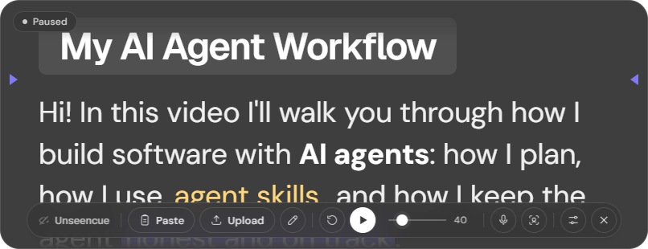
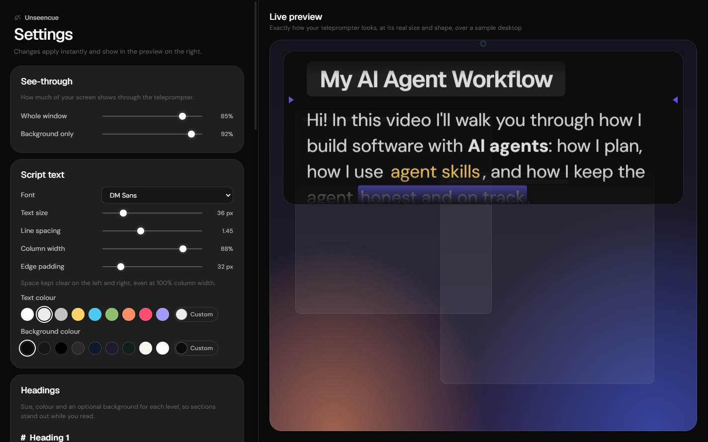

<div align="center">

# Unseencue

**A teleprompter for creators that sits right under your webcam.**

Read your script while you look straight into the lens. Unseencue is visible on your monitor but stays out of your screen recordings and screen shares, so your notes never end up in the video.

[**⬇ Download for Windows**](https://github.com/shivamshinde123/unseencue/releases/latest/download/Unseencue.exe) · [Website](https://shivamshinde123.github.io/unseencue/) · [Report a problem](https://github.com/shivamshinde123/unseencue/issues)



</div>

---

## Contents

- [Why I built it](#why-i-built-it)
- [Responsible use](#responsible-use)
- [Why Unseencue](#why-unseencue)
- [Features](#features)
- [Download and install](#download-and-install)
- [Quick start](#quick-start)
- [Writing your script](#writing-your-script)
- [Settings reference](#settings-reference)
- [Voice follow](#voice-follow)
- [Head follow](#head-follow)
- [How it stays hidden](#how-it-stays-hidden)
- [Privacy](#privacy)
- [Troubleshooting](#troubleshooting)
- [FAQ](#faq)
- [Build from source](#build-from-source)
- [Project structure](#project-structure)
- [Testing](#testing)
- [Architecture](#architecture)
- [Credits](#credits)

---

## Why I built it

A job application asked me to *walk them through my AI-agent workflow*: how I plan with agents, how I use agent skills, and how I put the pieces together to build applications. I wanted to show them, not just tell them, so I decided to record a video of my real workflow.

There was a lot to cover. Without a script I'd ramble, skip the parts that mattered, and drift off track. But reading a script from another window made my eyes wander away from the camera, and the script showed up in my screen recording. So I built Unseencue: a script that sits right under the webcam, keeps me on track, and stays out of the recording.

It's useful for anyone who makes videos: YouTube tutorials, product demos, course lessons, walkthroughs of your own work, or a talk you want to give smoothly. It's also handy for keeping your own agenda or talking points in front of you during a meeting or presentation you're running.

## Responsible use

> **Unseencue is not a cheating tool, and I don't endorse using it that way.**
>
> Don't use it in job interviews, coding assessments, exams, certifications, or any situation where you're expected to answer without notes, or where hidden help would mislead the people evaluating you. It's dishonest and unfair to everyone else, and that's not what this project is for.

It's for **your own content and presentations**: recording videos, demos and walkthroughs, and keeping your own talking points in front of you when notes are allowed. If you're not sure whether notes are OK in a situation, ask, or don't use it.

## Why Unseencue

When you read a script from another window, your eyes drift away from the camera and viewers notice. Hardware teleprompters fix that but are bulky and expensive. Unseencue puts your script in a slim, see-through strip **directly under your webcam**, so your eyes stay on the lens. Windows keeps the window out of every screen capture, so you can record your screen without your notes ending up in the video.

## Features

| | |
|---|---|
| **Stays out of your recordings** | Left out of screen recordings and screen shares (OBS, Loom, Xbox Game Bar, Snipping Tool, PrintScreen, and screen sharing in Zoom, Meet and Teams). You still see it. |
| **Sits under your webcam** | Opens at the top-left, top-centre or top-right of your screen, or at an exact spot you save as home. |
| **Paste or upload** | Paste text (button, Ctrl+V, or right-click), type it in, upload a `.txt`/`.md` file, or drag a file onto the window. |
| **Markdown + colour** | Headings, bold, italic, lists, tables, stage-cue boxes, breaks, and coloured or highlighted words. |
| **Voice follow** | Scrolls while you talk and pauses when you stop. It measures your room's noise by itself. |
| **Head follow** | Pauses when you look away from the screen and resumes when you look back. Runs on your computer; no video leaves it. |
| **Fully adjustable** | Any installed font, text size (12–140 px), spacing, column width, edge padding, colours, heading styles, reading marker, see-through level. |
| **Live preview** | Settings show a real-size preview of your teleprompter over a sample desktop, updating as you change things. |
| **Countdown** | 0–30 seconds before scrolling starts. |
| **Remembers your place** | Each script reopens where you left off. |
| **Resizable and movable** | Drag any edge or corner to resize; drag the grab bar to move. Rounded, translucent window. |

## Download and install

1. Download **[Unseencue.exe](https://github.com/shivamshinde123/unseencue/releases/latest/download/Unseencue.exe)** (about 80 MB) from the [latest release](https://github.com/shivamshinde123/unseencue/releases/latest).
2. Double-click it. It's a portable app: no installer, nothing to uninstall. Put it anywhere, for example on your desktop or taskbar.
3. **Windows SmartScreen** may say "Windows protected your PC" because the app isn't code-signed yet. Click **More info → Run anyway**.

**Requirements:** Windows 10 version 2004 (May 2020 update) or later, or Windows 11. Hiding from capture needs 2004 or later. A microphone for voice follow and a webcam for head follow are optional.

## Quick start

1. **Open Unseencue.** It appears at the top-centre of your main screen, under the webcam.
2. **Add your script.** Hover over the window to show the control bar, then:
   - click **Paste** to use text you copied, or
   - click **Upload** to open a `.txt` or `.md` file, or
   - click **✎** to type, or drag a file onto the window.
3. **Press ▶.** A countdown runs, then the text scrolls. Adjust **speed** with the slider in the bar.
4. **Line up your eyes.** Read at the **reading marker** (the small arrows). Move it higher or lower in Settings so it sits as close to your lens as possible.
5. **Check it's hidden.** In ⚙ Settings → *Hidden from recordings & meetings*, click **Check it's hidden now**. You should see your desktop in the result, not your script.

### The control bar


| Control | What it does |
|---|---|
| Unseencue | The app's name. It only shows when the bar does. |
| **Paste** | Uses the text on your clipboard as the script. |
| **Upload** | Opens a `.txt` or `.md` file. |
| ✎ | Opens the editor to type or change the script. |
| ⟲ | Back to the top. |
| ▶ / ⏸ | Start (with countdown) / pause. |
| Speed slider | Scroll speed in pixels per second. |
| 🎤 | Voice follow on/off. A white dot means it hears you. |
| ☺ | Head follow on/off. |
| `12% · 1:42` | Progress and estimated time left (hidden on narrow windows). |
| ⚙ | Settings. |
| ✕ | Quit. |

The mouse wheel nudges the script up or down, which is handy while paused. The bar hides itself while scrolling and comes back on hover.

## Writing your script

Plain text works. For structure and emphasis, Unseencue understands Markdown plus a colour shorthand. Open **Formatting help** in the editor and click any example to insert it.

| You type | You get |
|---|---|
| `# Heading` | Big heading |
| `## Section` | Section heading with a soft underline |
| `### Subheading` | Small, all-caps heading |
| `**bold**` / `*italic*` | **bold** / *italic* |
| `{red}word{/}` | Coloured word (names like `red`, or hex like `#ffd166`) |
| `{black\|#ffd166}word{/}` | Word on a coloured highlight |
| `{\|#333}word{/}` | Highlight only |
| `- point` | Bullet list |
| `1. step` | Numbered list |
| `> CUE: smile here` | Small stage-cue box: a note to you, not a line to read |
| `---` | Section break |
| `\| a \| b \|` tables | A compact table that fits the column |

Example:

```markdown
# Welcome to the Channel
Hey everyone! Today we're building something {#ffd166}really useful{/}.

## Part 1 · Why This Matters
Keeping the words close to the lens makes you look **confident**.

> {black|#ffd166}CUE:{/} Smile here, then lean in.

---
```

A full example covering every style ships with the app: [`renderer/sample-script.txt`](renderer/sample-script.txt). It's a short script for walking through an AI-agent workflow, the video this app was built for.

> Pasted or typed scripts are stored inside the app. Files you upload are never modified.

## Settings reference

Open with ⚙. Settings is a large window: the controls are on the left and a **live preview** is on the right. Every change applies instantly.



| Section | Settings |
|---|---|
| **See-through** | *Whole window* opacity (text, colours and controls) and *Background only* opacity. |
| **Script text** | Font (any installed font, each shown in its own face; headings follow it unless it's the default DM Sans), text size 12–140 px, line spacing, column width, edge padding (space always kept at the sides), text colour, background colour. |
| **Headings** | For `#`, `##` and `###`: size (% of the body text), colour, optional background, plus background strength. |
| **Reading marker** | Style: *Arrows* (default), *Glow*, *Line*, *Band*, *None*; colour; height from the top. |
| **Playback** | Scroll speed, countdown length (0–30 s). |
| **Voice follow** | On/off, live mic meter, *Louder than room by* (sensitivity), *Stop after silence*. |
| **Head follow** | On/off, camera, look-away tolerance. |
| **Position under your webcam** | Top left / Top centre / Top right, **Save current spot as home**, **Move back home**. |
| **Hidden from recordings & meetings** | What it hides from, **Check it's hidden now**, **Reset look to defaults** (keeps your script, place and home spot). |

Every colour setting has ready-made swatches plus a **Custom** picker at the end.

## Voice follow

Turn on 🎤 (or Settings → Voice follow). The script scrolls only while you're speaking and stops shortly after you go quiet.

- It tracks your room's **background noise** continuously and triggers when your voice is a set number of dB louder (default 16 dB). It works the same on a quiet USB mic or a noisy laptop mic, with no calibration.
- The Settings meter shows your live level and the trigger line (violet). If it doesn't start, lower **Louder than room by**. If fan or keyboard noise keeps it scrolling, raise it.
- It shares the microphone with your recorder or meeting app.

## Head follow

Turn on ☺ (or Settings → Head follow). Scrolling pauses when you turn away from the screen and resumes when you look back.

- It learns where "looking at the screen" is during each countdown, so there's no calibration step.
- It uses Google's MediaPipe face-landmark model, which **runs entirely on your PC**.
- **Webcam sharing:** Windows usually lets only one app use a webcam at a time. If OBS or your meeting app already has it, choose a virtual camera in Settings → Head follow → Camera. For example, in OBS click *Start Virtual Camera* and pick **OBS Virtual Camera**. If the camera is busy, head follow switches off with a message and everything else keeps working.

## How it stays hidden

Unseencue asks Windows to exclude its windows from capture (`SetWindowDisplayAffinity` with `WDA_EXCLUDEFROMCAPTURE`, available since Windows 10 version 2004). Windows then leaves those windows out of every capture path that apps use (Windows Graphics Capture, DXGI desktop duplication and GDI), so screen recorders and screen shares see whatever is *behind* the teleprompter.

It was verified with two methods:
- the modern capture path used by Chrome (so Google Meet), Teams, Zoom and OBS
- the classic GDI path used by PrintScreen-style tools

Both show the desktop, not the script. The Settings window is hidden the same way.

**Limits:** it can't hide from a camera physically pointed at your monitor, from hardware capture cards plugged into your display output, or from software running on very old Windows builds. Your **webcam video never shows your screen** in the first place.

## Privacy

- **Everything runs locally.** No account, no analytics, and no network requests at runtime. The fonts and the face model are bundled.
- Microphone audio is only measured for loudness; it's never recorded or stored.
- Webcam frames are only used to estimate head direction; they're never recorded or stored.
- Settings and pasted scripts are stored in `%APPDATA%\Unseencue\settings.json`.

## Troubleshooting

| Problem | Fix |
|---|---|
| "Windows protected your PC" | The app isn't code-signed yet. Click **More info → Run anyway**. |
| I can't see the window | Settings → **Move back home**. If the screen it was on is disconnected, it moves back to your main screen automatically. |
| It shows up in my recording | Check you're on Windows 10 version 2004 or later (`winver`). Run **Check it's hidden now**. |
| Voice follow doesn't start | Windows Settings → Privacy & security → Microphone → allow desktop apps. Lower *Louder than room by*. |
| Voice follow never stops | Raise *Louder than room by* or shorten *Stop after silence*. |
| Head follow says the camera is in use | Pick a virtual camera (e.g. OBS Virtual Camera) in Settings → Head follow → Camera. |
| The 🎤 or ☺ button turns red | Permission or device problem. The message at the top-left of the window says which. |
| Paste does nothing | Your clipboard has no text (e.g. you copied a *file* in Explorer). Use **Upload** or drag the file in. |
| I want the default look back | Settings → **Reset look to defaults**. |

## FAQ

**Does it work on macOS or Linux?** Not yet. The capture-hiding relies on a Windows API. Electron's equivalent on macOS hides from many recorders but not all, so it hasn't been enabled or tested there.

**Is it free?** Yes.

**Can people in my Zoom/Meet/Teams call see it if I share my screen?** No, they see what's behind it. That's for keeping your own talking points handy when notes are fine, **not** for interviews, assessments or exams. See [Responsible use](#responsible-use).

**Will it show in my OBS recording?** No, whether you capture the display or a window.

**Can I use it with an external webcam on top of a second monitor?** Yes. Move the window under that webcam and click **Save current spot as home**.

**Does it change my script files?** Never. Edits to an uploaded file become an in-app copy.

## Build from source

Requirements: Windows 10 2004+ / 11, [Node.js](https://nodejs.org) 20+.

```bash
git clone https://github.com/shivamshinde123/unseencue.git
cd unseencue
npm install
npm start
```

Build the portable exe (output: `release/Unseencue <version>.exe`):

```bash
npm run dist
```

The face-landmark model is included in `models/`. To download it again:

```bash
npm run fetch-model
```

## Project structure

```
main.js                 Electron main process: capture-hidden windows, settings file, IPC, self-tests
preload.js              The window.api bridge (context isolation on, no Node in pages)
renderer/
  tokens.css            Design tokens, bundled fonts, shared pill/slider styles
  tooltip.js            Themed tooltips
  index.html, prompter.css, prompter.js   The teleprompter (scrolling, editor, resizing, controls)
  settings.html, settings.css, settings.js   Settings window with live preview
  markdown.js           Script text → HTML (Markdown + colour shorthand)
  voice.js              Voice follow (adaptive noise floor)
  head.js               Head follow (MediaPipe face landmarks)
  sample-script.txt     Example script with every style
models/                 MediaPipe face-landmarker model (runs offline)
site/                   The one-page website (GitHub Pages)
docs/                   Product, architecture and decision records
test/                   Unit tests
```

## Testing

```bash
npm test                          # unit tests: Markdown/colour parsing, voice noise-floor logic
npm run selftest                  # launches the app, renders, loads the face model, probes the mic
```

The app has built-in self-tests, run as `electron . --selftest=<view>`. Screenshots are written to `%TEMP%`.

| View | Checks |
|---|---|
| `script` | Renders the sample script and shows a tooltip. |
| `editor` | The paste/type editor. |
| `settings` | Settings window and live preview (top, middle, bottom screenshots). |
| `paste` | Presses a real Ctrl+V inside and outside the editor (your clipboard is restored). |
| `table` | Markdown tables fit the column. |
| `walk` | **Clicks through every setting** (35 steps) with real mouse events and screenshots each one into `%TEMP%\tp-walk`, with a `walk-log.json`. Your own settings are restored afterwards. |

## Architecture

- **Electron.** Both windows call `setContentProtection(true)`, which applies `WDA_EXCLUDEFROMCAPTURE` on Windows.
- **The teleprompter window** is frameless and transparent so it can have rounded corners. Because Windows can't natively resize transparent windows, it uses its own 8 resize handles.
- **Scrolling** runs on `requestAnimationFrame` and only advances while every gate is open: *playing*, *countdown finished*, *talking* (voice follow) and *looking* (head follow).
- **Settings** live in one JSON file owned by the main process. Every change is broadcast to all windows.
- **The live preview** in Settings is the real teleprompter page in an iframe (`index.html?preview`), so it can never drift from the app.
- **Files** are served over a private `app://` scheme so the MediaPipe WebAssembly, model and fonts load offline.

More detail is in [`docs/`](docs/): requirements, architecture, the decision log, the UI spec and the code flow.

## Credits

- Visual design follows the [Dimension style reference](https://styles.refero.design/style/fbcf9cbb-7c6b-449d-862a-bce521a8ab1d) on Refero Styles.
- [Electron](https://www.electronjs.org), [marked](https://marked.js.org), [MediaPipe Tasks Vision](https://ai.google.dev/edge/mediapipe), and the [DM Sans](https://fonts.google.com/specimen/DM+Sans) and [Geist](https://vercel.com/font) fonts via Fontsource.

**License:** not chosen yet. Until a license file is added, all rights are reserved by the author.
